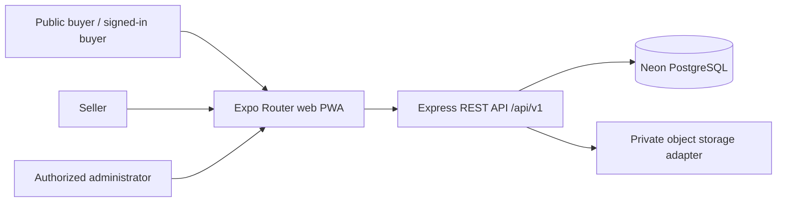

# Architecture

## System Context

AgriMarket is a mobile-first B2B directory. Buyers browse public listings and authenticated buyers send enquiries. Sellers maintain one business profile, listings, private verification submissions, and an inbox. Authorized administrators review verification and moderation actions. There is no checkout, payment, fulfilment, logistics, or real-time chat.

## Framework And Deployment Decisions

- Client: preserve the existing Expo Router / React Native Web project in `mobile/`. The canonical `app.json` uses Expo SDK 58 static web output with a checked-in manifest, raster install icons, and a generated Workbox service worker. No separate native app is introduced.
- Duplicate client directory: `mobile/AgriMarket/` duplicates the outer app and is not the canonical build root. Preserve it without changes; use `mobile/` for commands and app changes until the duplicate can be reconciled deliberately.
- API: Node.js + TypeScript + Express 5, versioned under `/api/v1`.
- Data: Neon-hosted PostgreSQL using Drizzle ORM and checked-in SQL migrations. No MongoDB is used.
- Validation: Zod at request and environment boundaries.
- Browser authentication: opaque server-side sessions in HttpOnly cookies; tokens are random and only HMAC-SHA256 hashes keyed by `SESSION_SECRET` are stored. Production cookies are Secure and SameSite=None for the separately hosted PWA; local HTTP uses SameSite=Lax. State-changing requests require an allowlisted Origin.
- Hosting: deploy the API to Render and the statically exported client to a static host (Render Static Site is a supported option). Neon is the proposed PostgreSQL provider. Cloudify's responsibility is TBD.
- Uploads: separate private-document and public-image storage adapters are implemented. The local adapter is development-only; the API refuses local storage in production. Until production private object storage and a durable public image bucket/CDN adapter are configured, production uploads are unavailable.

## Design And Navigation

The Figma Make home screen was inspected: supplier search, verified-seller reassurance, categories, province selection, listing cards, and bottom navigation. The separate Figma design file requires sign-in, so its unseen screens were not treated as inspected. The implementation uses this screen inventory: Home/Search, static listing detail (`/listing?id=...`), Account/Auth, seller workspace, buyer/seller Enquiries, and protected Admin review.

The interim design tokens follow the visible reference without claiming a complete Figma handoff: forest `#183f32`, leaf `#3b7058`, harvest `#e8b74d`, clay `#d98a51`, paper `#f3f5ed`; Georgia display headings with a Spline Sans/Trebuchet body fallback; compact panels/cards use 8px radii, thin borders, and a restrained 8/14/20/28px spacing rhythm. Navigation is fixed at the bottom on mobile and content is capped at 1120px on larger screens; the hero changes layout below 620px. Listings show loading, empty, retry/error, and success states. Photo uploads require alt text and are normalized to WebP at a maximum 1600px before delivery.

## Data And Request Flow

The browser calls the API over HTTPS. The API validates payloads, establishes the user from its session, applies role and ownership checks, then uses Drizzle transactions for persistent changes. Public listing queries include only published listings owned by approved businesses; business verification and listing publication are separate admin decisions. Verification metadata and internal moderation notes are never part of public response schemas. Uploaded bytes are stored outside PostgreSQL; only storage keys and review metadata are persisted. Sensitive administrator actions create audit records.

## PWA And Browser Support

The web app is exported as static HTML for public routes. The manifest provides standalone install metadata and 180/192/512px raster icons. Workbox precaches the app shell and uses bounded caching for same-origin static assets; all `/api/v1/` requests are NetworkOnly, and navigation fallback is `offline.html`. The worker registers only on HTTPS. Offline mode is informational/read-only and does not claim authenticated workflows work offline. Target current evergreen Chrome, Edge, Firefox, and Safari; install prompts vary by browser/platform.

## Local Commands

- Client: from `mobile/`, run `npm install`, `npm run web`, `npm run lint`, `npm run typecheck`, and `npm run build:web`.
- API: from `server/`, run `npm install`, configure `.env`, `npm run db:migrate`, `npm run db:seed`, `npm run dev`, `npm run typecheck`, and `npm test`.
- First admin, after migrations: `npm run admin:create-first -- admin@example.org`; the command prompts for a hidden password.
- Required external setup for persistent workflows: PostgreSQL connection string. Production also requires a session secret and private object-storage configuration.

## Trade-Offs

Expo is retained because the current React Native Web app meets the PWA requirements with static rendering, manifest, icons, and Workbox; a framework migration would discard an existing cross-platform project without enabling a missing capability. Static output favors a simple client deployment. Listing detail uses a query-based static route, `/listing?id=...`, so unknown dynamic paths do not depend on host rewrites.