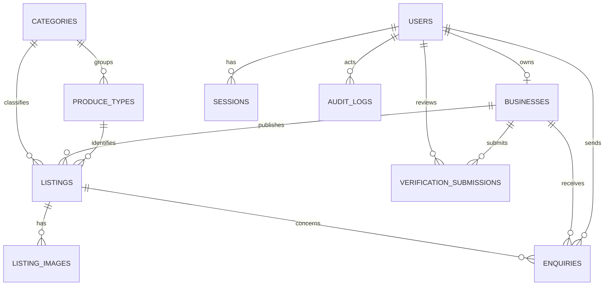

# Database

PostgreSQL is the system of record. IDs are UUIDs; timestamps are UTC `timestamptz`. Drizzle schema and SQL migrations are authoritative. Do not store binary uploads in PostgreSQL.

## Core Tables

- `users`: normalized unique email, bcrypt password hash, buyer/seller/admin role, account state, optional email verification time, optional buyer-owned saved location label/coordinates, timestamps. Public registration permits buyer/seller only. Live GPS is never stored.
- `sessions`: user FK, unique HMAC-SHA256 session-token hash, expiry, creation time. The raw opaque token exists only in the HttpOnly cookie.
- `businesses`: unique owner FK, name, description, private address, controlled province, optional town/contact fields, privately stored latitude/longitude for radius search, business verification status, timestamps. Address and coordinates are returned only to the owning seller and are not part of public response shapes.
- `categories`: controlled slug/name and active flag.
- `produce_types`: controlled category FK, produce name, and active flag; seeded with South African starter types.
- `listings`: business/category/produce-type FKs, title/description, province, optional area, product/service type, active and in-stock flags, optional expiry, draft/pending/published/rejected/archived state, timestamps.
- `listing_images`: listing FK, object storage key, order, required alt text, detected MIME, optimized WebP byte size and dimensions. Listing images use a public-image adapter separate from private verification storage.
- `verification_submissions`: business FK, private storage-key array, submitter/reviewer FKs, pending/approved/rejected status, seller-safe feedback, internal-only reason, submitted/reviewed times. Storage keys and internal notes are excluded from seller/public response shapes.
- `enquiries`: buyer FK, business/listing FKs, bounded message, new/read/responded/closed status, created/updated timestamps, buyer-scoped idempotency key.
- `audit_logs`: actor FK, action, target type/UUID, timestamp, minimal non-sensitive metadata.

## Constraints And Indexes

Email is unique after normalization; `businesses.owner_id` is unique; category slug and per-category produce name are unique; coordinates are range-checked and latitude/longitude indexed for bounding-box prefiltering; province/status/type use controlled values; listing title/message sizes are bounded; enquiry references must remain consistent. Radius search applies a parameterized Haversine calculation after the indexed bounding-box filter. Index listing publication/business/category/province and produce availability, GIN full-text search for listing/supplier text, verification status/submitted time, enquiry business/buyer/status/time, and session token hash/expiry. A partial unique index permits one pending verification per business; photo uploads are transactionally limited to five per listing. Use restrictive deletion for audit/privacy-relevant references; deletion/retention behavior must be documented before production.

## Migration And Seed Strategy

Use checked-in Drizzle SQL migrations. Run `npm run db:generate` after schema changes, `npm run db:check` to verify migration ordering, and `npm run db:migrate` against a disposable configured `DATABASE_URL` to apply them. Migration `0004` adds buyer and seller locations, controlled produce types, inventory eligibility fields, and the six market categories; `0005` adds the seller location index; `0006` adds the seller's private business address. Companion `.down.sql` files document rollback order. `npm run db:seed` idempotently creates the six market categories and starter produce types; it does not create test users or real data. Bootstrap the first admin only through the hidden-password `npm run admin:create-first -- admin@example.org` procedure, never public registration.

## Data Retention

Set retention periods for rejected verification files, closed enquiries, inactive accounts, and audit logs after privacy/legal review. Deletion requests must preserve only records legally or security-required, with access restricted and rationale recorded.